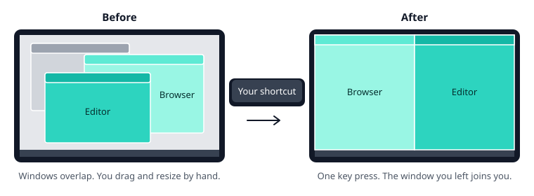
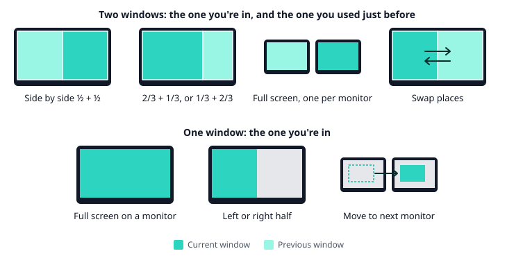
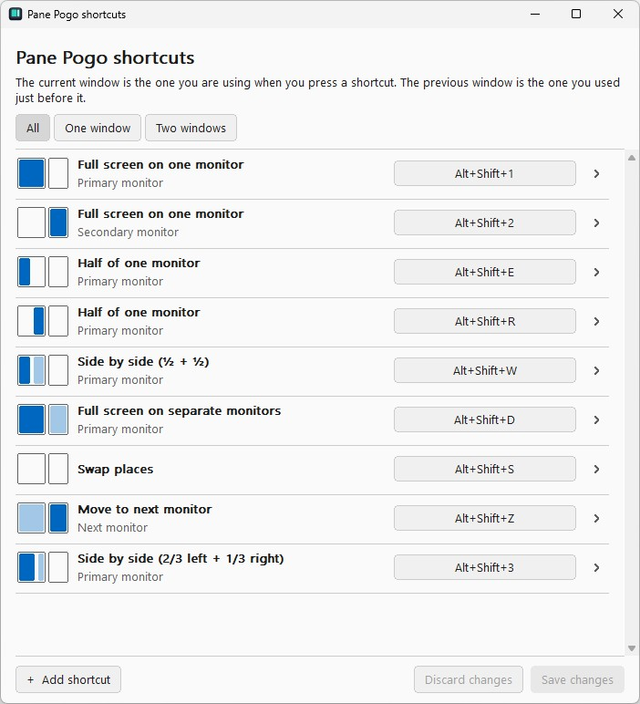

<p align="center">
  
</p>

<h1 align="center">pane-pogo</h1>

<p align="center"><b>Need a second app beside you? One key.</b><br>
Work full screen. Press a shortcut and the app you used just before lands next to you. Press another and you're full screen again.</p>

<p align="center">
  
</p>

## The problem

You're writing in one window and reading from another. They overlap, so you keep switching, dragging and resizing. Windows Snap helps, but it places one window at a time. You snap the first, then pick the second from a row of thumbnails, and you do it all again for the next pair.

## What pane-pogo does

Press a shortcut, and pane-pogo arranges the window you're in and the window you used just before it. It tracks which window you came from, so you never reach for the mouse or pick from thumbnails.

A typical day:

1. You work full screen in your main app.
2. You need the other app. One key brings it next to you.
3. You're done with it. One key makes your main app full screen again.
4. Repeat as often as you like.
5. With two monitors, one key puts each app full screen on its own monitor.
6. If your focus moves to the other app, use **Swap places** to trade their positions.

Each shortcut stores its own layout (halves, 2/3 + 1/3, 1/3 + 2/3, or one window per monitor), the side the current window goes to, the monitor it uses, and the window you can type in afterwards. So one shortcut can mean "browser on the left, me on the right, keep typing here", and another can mean "notes as a 1/3 strip on the second monitor".

## Layouts

<p align="center">
  
</p>

| Action | What happens |
|---|---|
| Side by side (½ + ½) | The current and previous window share a monitor, half each. |
| Side by side (2/3 + 1/3), (1/3 + 2/3) | The same, with one window 2/3 wide and the other 1/3. |
| Full screen on separate monitors | Each window fills its own monitor. |
| Swap places | The two windows trade position and size. |
| Full screen on one monitor | The current window fills the primary or secondary monitor. The taskbar stays visible. |
| Half of one monitor | The current window fills the left or right half of a monitor. |
| Move to next monitor | The current window moves to the next monitor and keeps its size. |

## When to use it

pane-pogo fits you if:

- You work in pairs of windows: code and docs, email and calendar, a spreadsheet and the report it feeds.
- You'd rather press keys than drag windows around.
- You use one or two monitors and want a window to land on the same one every time.
- You want unequal splits, such as a wide editor beside a narrow chat or notes window.

Look elsewhere if:

- You want a grid of three or more windows, or custom zones. Try PowerToys FancyZones.
- You want every new window tiled automatically. Try a tiling window manager.
- Your monitors use different display scaling. See [Known limitations](#known-limitations).

## Set up your shortcuts

Right-click the tray icon and choose **Settings...**

<p align="center">
  
</p>

1. Click **Add shortcut**.
2. Pick the action. Hover over any action or setting to see what it does.
3. Click the shortcut box and press the keys: Ctrl, Alt or Shift with a letter, a number or F1 to F12. **Esc** cancels.
4. Expand the row with **›** to choose the side, the monitor and the final focus.
5. Click **Save changes**. The shortcut works at once.

### Default shortcuts

On first run, pane-pogo creates these shortcuts. They are only defaults: change or remove any of them in Settings.

| Shortcut | What happens |
|---|---|
| `Alt+Shift+1` | Current window fills the primary monitor. |
| `Alt+Shift+2` | Current window fills the secondary monitor. |
| `Alt+Shift+E` | Current window takes the left half of the primary monitor. |
| `Alt+Shift+R` | Current window takes the right half of the primary monitor. |
| `Alt+Shift+W` | Side by side on the primary monitor. Current window left, previous window right. You keep typing in the current window. |
| `Alt+Shift+D` | Each window fills its own monitor. Current window on the primary monitor. You keep typing in the current window. |
| `Alt+Shift+S` | Swap places: the two windows trade position and size. |
| `Alt+Shift+Z` | Move the current window to the next monitor, keeping its size. |

If another program already uses one of them, pane-pogo shows a notification on first run and Settings marks that row. Pick a different shortcut there.

## Install

Download `pane-pogo.exe` from the [latest release](../../releases/latest) and run it. It appears in the system tray; if you can't see it, look under the `^` arrow.

To start it at sign-in, right-click the tray icon and tick **Start with Windows**. pane-pogo copies itself to `%LOCALAPPDATA%\Programs\pane-pogo\` and starts from there.

To build from source, install [Rust](https://rustup.rs), then run:

```powershell
cargo build --release
.\target\release\pane-pogo.exe
```

Requirements: Windows 11. Windows 10 is untested.

## Privacy

pane-pogo works offline. It has no network code, no telemetry and no account. Your shortcuts live in `%APPDATA%\pane-pogo\bindings.json`, a plain text file you can read, edit or back up.

## Known limitations

- Monitors with different display scaling can make windows land in the wrong place.
- Windows' invisible resize borders leave gaps of about 7 px between tiled windows.
- Windows running as administrator can't be moved, because pane-pogo doesn't run as administrator.
- An app that can't shrink to 1/3 of the screen overlaps its neighbour.
- With three or more monitors, which one counts as "secondary" can change after docking or a restart.
- `Alt+Shift` also switches the input language when you have several keyboard layouts installed. The default shortcuts use `Alt+Shift`, so change them to `Ctrl+Shift` in Settings if this affects you.
- SmartScreen may warn on first run, because the exe isn't code-signed yet.

## Uninstall

1. Right-click the tray icon, untick **Start with Windows**, then choose **Exit**.
2. Delete `%LOCALAPPDATA%\Programs\pane-pogo\`.
3. To remove your shortcuts and logs, delete `%APPDATA%\pane-pogo\`.

## More

- [How to use pane-pogo](docs/how-to.md)
- [Specification](docs/spec.md)
- [Project site](https://wayanlw.github.io/pane-pogo/)

## License

[MIT](LICENSE)
